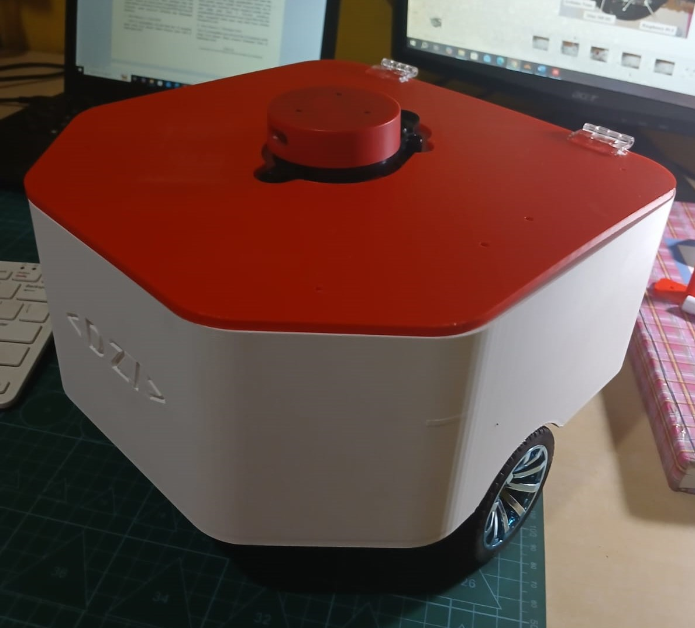
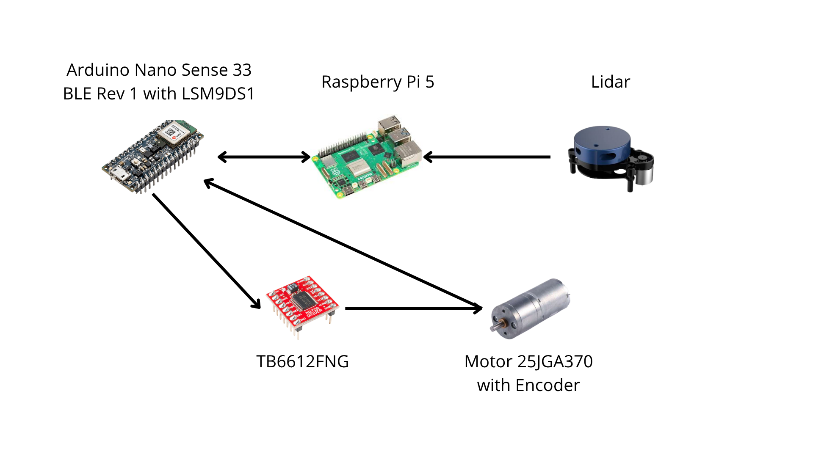
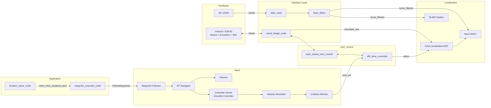

# 🤖 Mino: Autonomous Mobile Robot

Autonomous navigation stack for **Robot Mino**, a differential-drive robot built on **ROS 2**, **Nav2**, **SLAM Toolbox**, and **ros2_control**. This repo contains the `robot_mino_control` package, which covers hardware bringup, localization (EKF + AMCL), mapping, navigation, and custom nodes for saving named locations and executing waypoints by name.


<p align="center">
  
</p>

## 🧰 Tech Stack

### Framework & Middleware
| Tool | Purpose |
|---|---|
| **ROS 2** (`rclpy`, `ament_python`) | Core middleware and package build system |
| **ros2_control** + `controller_manager` | Hardware abstraction and controller management (50 Hz) |
| **`topic_based_ros2_control`** | Topic-based hardware interface, bridging ros2_control to the firmware through a serial bridge |
| **`diff_drive_controller`** | Differential-drive kinematics, producing odometry and wheel velocity commands |
| **`joint_state_broadcaster`** | Publishes wheel joint states |
| **`xacro`** + `robot_state_publisher` | Robot description (URDF) and static TF publishing |

### Localization & Mapping
| Tool | Purpose |
|---|---|
| **`robot_localization`** (EKF) | Sensor fusion of wheel odometry + IMU (2D mode, 30 Hz) |
| **SLAM Toolbox** (`async_slam_toolbox_node`) | Online mapping with loop closure, 0.05 m map resolution |
| **Nav2 AMCL** | Localization on a static map using `DifferentialMotionModel` |
| **Nav2 Map Server** | Loads maps (`.pgm` + `.yaml`) |
| **`laser_filters`** | Scan pre-processing (speckle filter and 0.12–8.0 m range filter) |

### Navigation (Nav2)
| Component | Plugin / Configuration |
|---|---|
| **Planner** | `nav2_navfn_planner::NavfnPlanner` |
| **Controller** | `nav2_graceful_controller::GracefulController` (DWB available as an alternative, commented out in the config) |
| **Costmap** | Local: `VoxelLayer` + `InflationLayer`; Global: `StaticLayer` + `ObstacleLayer` + `InflationLayer` |
| **Behavior Tree** | `bt_navigator` |
| **Recovery** | `nav2_behaviors` (Spin, BackUp, Wait) |
| **Velocity Smoother** | `nav2_velocity_smoother` |
| **Collision Monitor** | `nav2_collision_monitor`, scan-based |
| **Waypoint Follower** | `nav2_waypoint_follower` + `WaitAtWaypoint` |
| **Lifecycle Manager** | `nav2_lifecycle_manager` |

### Hardware & Communication


| Component | Notes |
|---|---|
| **Arduino Nano Sense 33 BLE Rev 1** (Arduino/ESP32) | Control PID and motor driver. Builtin with IMU LSM9DS1  |
| **TB6612FNG ** | Motor Driver |
| **DC motors 25JGA370 + encoders** | 1012 counts/rev |
| **Yd Lidar X4** | Read over serial by `lidar_node`, published as `/scan` |
| **Raspberry Pi 5** | Runs the entire ROS 2 stack |

### Python Libraries
`pyserial` · `numpy` · `scipy` · `matplotlib` · `Pillow` · `PyYAML`

---

## 🏗️ Architecture



**Data flow at a glance:**
1. The firmware streams telemetry `#ts,ticksL,ticksR,rpmL,rpmR,ax,ay,az,gx,gy,gz` over serial.
2. `serial_bridge_node` converts it into `/topic_based_joint_states` and `/imu/data_raw`, and forwards wheel velocity commands (`wL,wR`) back to the firmware.
3. `diff_drive_controller` produces odometry, and the EKF fuses it with the IMU into `/odometry/filtered` (TF `odom → base_footprint`).
4. SLAM Toolbox (mapping) or AMCL (navigation) provides the `map → odom` TF.
5. Nav2 plans a path, and velocity commands pass through the velocity smoother and collision monitor before reaching `diff_drive_controller`.

---

## 📦 Repository Structure

```
Nav2-Robot-main/
└── robot_mino_control/
    ├── config/
    │   ├── controllers.yaml        # ros2_control + diff_drive_controller
    │   ├── ekf.yaml                # robot_localization (odom + IMU)
    │   ├── laser_filters.yaml      # speckle + range filter
    │   ├── slam_toolbox.yaml       # mapping parameters
    │   └── nav2_params.yaml        # all Nav2 parameters
    ├── launch/
    │   ├── bringup.launch.py       # hardware + EKF + LiDAR + optional SLAM
    │   └── navigation.launch.py    # Nav2 stack (map server, AMCL, planner, etc.)
    ├── location/
    │   └── robot_mino_locations.yaml   # named locations (ruang1, ruang2, ...)
    ├── maps/                       # SLAM-generated maps (.pgm + .yaml)
    ├── mesh/                       # base_hexagon.stl
    ├── urdf/
    │   └── robot_mino.urdf.xacro   # robot model + ros2_control tags
    └── robot_mino_control/         # Python nodes
        ├── serial_bridge_node.py
        ├── lidar_node.py
        ├── location_saver_node.py
        └── waypoint_executor_node.py
```

---

## 🧩 Custom Nodes

| Node | Purpose |
|---|---|
| `serial_bridge_node` | Serial ↔ ROS 2 bridge for wheel commands, joint states, and IMU data |
| `lidar_node` | Parses LiDAR serial packets into `sensor_msgs/LaserScan` (`/scan`, 360°, 1° resolution) |
| `location_saver_node` | Service that saves the robot's current pose (TF lookup `map → base_link`) to YAML as a named location |
| `waypoint_executor_node` | Action server that accepts a list of location *names*, validates them, and forwards them to Nav2 `FollowWaypoints` |

> The custom interfaces (`SaveLocation`, `ListLocations`, `ExecuteWaypoints`) live in a separate package, **`robot_mino_interfaces`**, which must be present in the same workspace.

---

## ⚙️ Key Parameters

| Parameter | Value | File |
|---|---|---|
| Controller update rate | 50 Hz | `controllers.yaml` |
| Wheel separation / radius | 0.20 m / 0.025 m | `controllers.yaml` |
| Max linear velocity | 0.15 m/s | `controllers.yaml`, `nav2_params.yaml` |
| Max angular velocity | 0.75 rad/s | `controllers.yaml`, `nav2_params.yaml` |
| EKF frequency | 30 Hz | `ekf.yaml` |
| Map / costmap resolution | 0.05 m | `slam_toolbox.yaml`, `nav2_params.yaml` |
| LiDAR range | 0.12 – 8.0 m | `laser_filters.yaml` |
| Serial baud rate | 115200 | `bringup.launch.py` |

> ⚠️ Physical values (`wheel_separation`, `wheel_radius`, mass) should be re-measured and kept consistent between `controllers.yaml` and `robot_mino.urdf.xacro`.

---

## 📄 License

Apache-2.0

